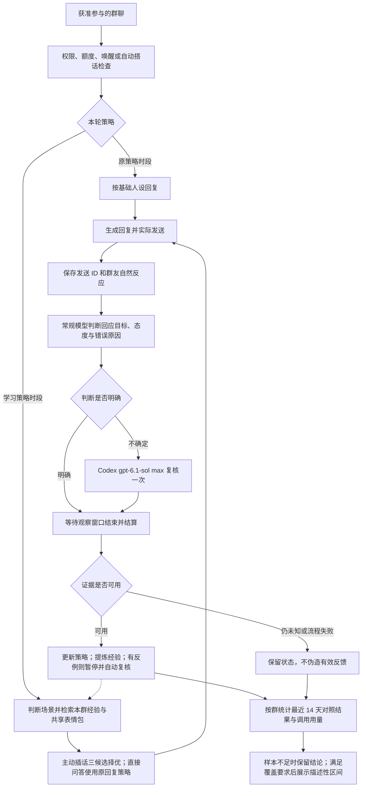
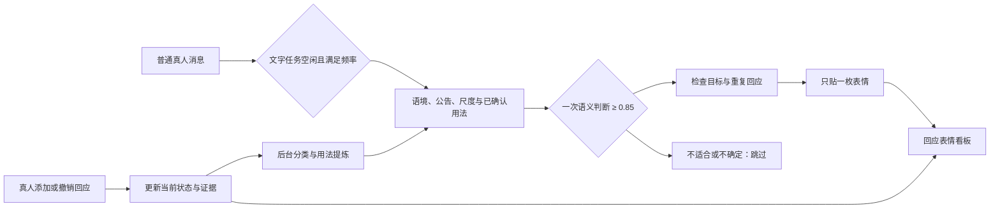

<div align="center">

# 💬 QQ 群聊学习

**从群友的自然反应里学习怎样接话，整个学习闭环无需人工打标签。**

AstrBot 完整插件 · 回复反馈 · 群内黑话 · 表情包 · 权限与人设

[](metadata.yaml)
[](https://github.com/AstrBotDevs/AstrBot)
[](#运行环境)
[](LICENSE)

[功能](#功能) · [学习流程](#学习流程) · [安装配置](#安装配置) · [看板](#学习看板) · [数据与隐私](#数据与隐私) · [研究参考](#研究参考)

</div>

`astrbot_plugin_qq_chat_control` 在 AstrBot 中显示为 **QQ 聊天控制**。它把 QQ 权限、群模型、人设、自动搭话和群聊学习放在同一个插件中，复用消息回执与请求生命周期，直接安装即可配置。

学习对象是**表达方式、相关经验、群内词义和配图选择**。系统保留基础人设，不微调聊天模型的权重，也不根据互动分自行提高发言频率。你需要配置模型与启用范围，之后由程序完成观察、判断、复核、更新和评估。

日常学习直接使用已启用群中的真人发言，不需要下载大型语料。后台把发言整理为少量“场景 → 表达方式 → 使用边界”，回复时最多取三条相关参考；实际发送后的反馈再修正经验。


> 截图使用合成数据。群号、账号、消息和统计均为演示内容，不包含真实聊天记录，也不代表实际效果。

## 功能

### 达到聊天次数上限

成员首次用完本轮聊天次数时，结合本群人设、已确认的表达方式和公告边界生成一句自然的结束语，不报重置时间、不引导付费。同一成员在本群、本轮周期内重复触发时复用原句，重载后仍保留；周期恢复后下次超限重新生成。模型失败时使用简短备用句并复用，不反复调用。不同群和人设分别处理，实际次数与白名单规则不变。

### 自主群名片与头像

“名片与头像”页提供 **补充头像候选**：每轮检查一页图片，最多加入5张合格候选，数量不足时保留实际结果；只入池，不更换QQ头像。可在自动头像开关关闭时使用。再次补充会查看后续分页。每张候选的 **使用这张** 按钮经确认后执行一次账号头像更换，保留自动开关原值；操作状态及结果显示在本页。

学习看板 → **设置 → 本群设置 → 自动群名片**：独立开关，参考本群近期聊天、活跃成员名片和群人设，生成自己的名字。名字不带固定前缀，不照抄其他成员。默认随机冷却 6–12 小时，滚动 24 小时最多两次；没有新聊天时保持原名。

学习看板 → **设置 → 通用设置 → 自动账号头像**：独立开关，先选择平台和账号主形象人设。头像影响账号所在的所有群，默认随机冷却 48–96 小时。图片来自 [Danbooru Safe](https://safebooru.donmai.us/) 的 general 图片；无搜索结果时查询 [Safebooru](https://safebooru.org/)。仅接收不超过 10 MiB、2,000 万像素的静态图片，经模型检查角色与裁剪效果后进入候选池。来源页面保留在看板中，图片和私人数据不进入仓库。

两个开关默认关闭，均要求对应群已获学习授权。常规判断沿用本群判断模型，置信度存在歧义时由配置的 Codex 复核。前台忙时暂缓；每次修改前重新检查开关。检测到外部修改或发送结果未知时暂停自动覆盖，可在 **名片与头像** 页签查看原因、候选图片、动作记录并暂停或恢复。发送结果未知不自动重发，冷却状态跨重载保留。

| 能力 | 当前行为 |
| --- | --- |
| 自然反馈学习 | 通过真实发送 ID、引用链和附近接话，识别正向反馈、追问、纠错、反感及未知 |
| 不确定反馈复核 | 常规判断后，交给已配置的 `gpt-6.1-sol / max` Provider 复核一次；仍不确定时保留未知 |
| 表达策略 | 主动插话生成三条具体回复并择优，直接问答保持快速流程；可按群配置反串尺度 |
| 群背景 | 优先读取群名、公告，再结合聊天、合格群文件和相册理解本群主题 |
| 自动经验整理 | 从多条真实案例提炼有适用范围的经验；遇到反例暂停使用，再自动复核 |
| 群内黑话 | 保留同词多义，通过多轮、多人、原始消息证据确认用法，仅注入相关语境 |
| 表情包 | 学习群共用表情包池，语义检索后按当前群语境筛选；支持文字、纯图片、文字配图，保留 GIF |
| 对照评估 | 交替运行原策略与学习策略，比较新增接话、纠错、反感、重复及延迟 |
| 学习看板 | 查看各群资料、回复评分和依据、暂停经验、调用用量、词库与图库 |
| QQ 聊天控制 | 按群设置模型、人设、插话、冷场发言、短期记忆及成员调用额度 |
| 成员画像 | 按群维护简短画像与好感；成员可查看、更正、删除自己的记录 |
| 可选工作集成 | 为兼容的 Codex / Antigravity Provider 提供附件、工具、额度和过程反馈连接点 |

## 学习流程

可以分成三个持续运行的环节：**记录真实反应 → 自动判断与更新 → 对照检查结果**。功能在一次安装中提供，经验与评估证据则需要随着真实群聊逐步积累。



### 1. 先确认反馈来自哪里

只有实际发送的回复才进入观察。模型生成成功不等于 QQ 发送成功；发送回执、部分发送和判断失败会分别记录。

明确引用优先用于定位回应目标，非引用消息结合上下文判断。提问者反复追问与其他真人参与分开计算，机器人消息排除；配置 `feedback_bot_ids` 可以排除群内其他机器人。引用、回复数量和模型自评都不能直接当成赞同。

一轮回复在约 **10 分钟**的观察窗口后结算；待分析的相关反应会延后结算。正向接话、明确反感、纠错分别保留。只有群内仍活跃且没有相关反应时，才记录“群活跃但无接话”；群安静、证据不足、未知和失败不会被填成零分。

### 2. 不确定时由大模型复核

常规判断使用该群的 `feedback_judge_provider_id`，留空则沿用聊天模型，可以配置为 Gemini。以下情况触发一次复核：

- 态度为未知，或态度置信度低于 `0.75`。
- 没有明确引用目标，且归因置信度低于 `0.85`，或返回的目标与态度不一致。
- 已识别纠错或反感，但无法确定是事实、理解、表达还是配图问题。

复核 Provider 必须报告模型 `gpt-6.1-sol`、思考强度 `max`，并提供 `chat_only_context` 纯聊天边界。负面原因还必须附有当前群友消息中逐字存在的证据；模型编造的引用不被采纳。

复核失败时，对无法确认的部分保留未知，已经明确的原始反馈可以保留。系统不反复请求判断，也没有必须由管理员逐条打标签的队列。

### 3. 更新策略与经验

直接问答及关闭三候选择优时，LinUCB 的行动是“表达风格 × 回复形式”。同一行动下有多张候选图片时，图片数量不会重复扩大该行动的探索机会；策略记录行动概率和条件选图概率，使用 `10%` 随机探索，并抑制短时间内重复的行动。

严肃求助、任务、事实问题和不确定场景优先认真文字回复。用户明确索图与场景判断失败会单独归类，避免混入常规策略对照。

经验整理通常需要至少 **8 个新结算样本**，两次整理至少间隔 **15 分钟**；已确认反例可以提前满足样本触发条件。一条经验需要引用至少两条真实案例。候选生成声明参考条目，评审确认实际采用的子集，反馈判断再核对负面原因是否针对该条目；不会因一次负评暂停所有注入过的经验。未发送候选和模型评审分不进入奖励，部分发送与分析失败不强行评分。候选模式下的表情包真实反馈也参与图片统计。

黑话与表情包使用各自的证据流程：黑话需至少两轮、三条证据、两位成员及足够置信度才能确认；图片需通过内容识别、向量检索和当前语境筛选。相似度只用于排序，将共享池最相关的至多五张交给判断模型，适用置信度至少 0.85 才可入选；模型认为没有合适图片时仍用文字。普通照片、工作截图、文档和二维码不作为可学习表情包。

### 4. 检查结果，而不是只看一个分数

日常持续使用学习策略和自然配图可选择“学习”模式。“对照”模式每 **15 分钟**切换原策略与学习策略，原策略时段使用文字；明确索取表情包的请求单独判断。在最近 **14 天**内，按同一群、人设、策略版本和相邻半小时区块配对，再按 UTC+8 日期汇总、日期等权比较。

至少有 **7 个存在配对时段的日期**后，才展示按整日重采样 2,000 次得到的描述性 95% 区间。这个门槛只代表覆盖范围，不保证效果成立。看板同时保留：

- 新增真人接话、明确反感、纠错与未知样本比例。
- 近期文本或图片重复率、首条发送和完成延迟。
- 回复、场景判断、选图及后台学习调用的次数、失败和实际返回的 Token。

互动分不等于内容正确率。当前评估是持续学习中的时间交替观察，存在时段、话题和样本选择影响，不能当成严格因果实验，也不能替代人工标注基准的准确率评测。

## 运行环境

| 项目 | 要求 |
| --- | --- |
| AstrBot | 插件声明 `>=4.28,<5`；当前验证环境为 **4.28.2 / Python 3.12** |
| 平台 | QQ 的 `aiocqhttp` / OneBot 适配器，例如已经正常连接的 NapCat |
| 聊天 Provider | 已在 AstrBot 启用并能正常聊天的模型 |
| 常规判断 | 能返回结构化判断的聊天模型；使用表情包时还需要图片理解能力 |
| 向量模型 | 开启表情包时需要 AstrBot 原生 Embedding Provider |
| Codex 复核 | 兼容的 `gpt-6.1-sol / max` Provider，提供纯聊天上下文接口 |
| 页面 | AstrBot 自带插件页面，无需另开前端服务 |

**本仓库包含完整 QQ 聊天控制插件；模型 Provider、Codex / Antigravity CLI、账号登录与切换扩展需要自行安装配置。** 普通聊天与学习可使用标准 AstrBot Provider；严格 Codex max 复核和部分工作集成还依赖兼容的 Provider 实现，仅把一个普通接口的名称改成 Codex 并不能满足要求。

工作群的执行中转向需要 Provider 提供 `steer(origin, prompt, image_urls=...)` 接口：同一发起人再次 @ 机器人时，补充文字、图片或文件可送入当前任务，并进入会话历史；明确的“停止不查了”“取消任务”等短指令直接取消当前执行。限额聊天、自动搭话和其他成员不能借此操作该任务。Provider 不支持转向时，沿用 AstrBot 原生追加消息流程。

代码使用 AstrBot 的消息、Provider 和插件页面接口，也涉及内部会话接口；声明的版本范围不表示每个版本都已实测。

## 群背景与反串互动

开启学习的群默认读取群名、群公告、群文件和群相册。群名只是初始线索，公告约束主题和尺度，实际聊天修正长期兴趣。群资料按群隔离，管理员个人 QQ 空间不在读取范围。

| 配置 | 默认 | 行为 |
| --- | --- | --- |
| `group_background` | `true` | 群名、公告、习惯与背景检索总开关 |
| `group_file_learning` | `true` | 后台读取符合限制的群文件 |
| `group_album_learning` | `true` | 理解相册背景，不把相册照片加入表情包池 |
| `candidate_replies` | `true` | 主动插话一次生成三条并择优；全不合格时不发 |
| `banter_intensity` | `30` | 每群0–100整活尺度上限；模型可以收敛，不能自行提高 |
| `knowledge_document_mb` | `20` | TXT、Markdown、PDF正文、DOCX、XLSX大小上限，单位MiB |
| `knowledge_image_mb` | `10` | JPEG、PNG、WebP、GIF大小上限，同时限制单帧2000万像素 |

尺度0–20为轻玩梗，21–40为吐槽，41–60允许明显反串和跨作品拉踩，61–80为强反串及熟人互损，81–100允许更放开的调侃和符合本群习惯的粗口。明确要求停止或认真求助时收敛，不编造真人黑料。BanG Dream与偶像大师、原神与鸣潮等对比仅是可能的互动方式，是否使用由当前话题、公告和真实群习惯决定，不固定复读。

群名与公告在启动、重载及每六小时刷新，文件和相册遍历目录并增量更新。当前话题命中的文件名优先，其他内容从新到旧，每轮最多处理两个资料单元；每个文档单元最多嵌入八个1200字符片段，保存游标后继续。前台聊天期间不启动新的背景解析。

视频、音频、压缩包、可执行文件及超限资料直接排除，不提取视频封面或字幕，不通过缩小图片绕过限制。扫描PDF不做OCR。下载过程也限制字节数，临时文件处理后删除；这不会删除QQ群原文件。看板分别显示目录、待处理、已读、排除和失败状态，不把建立目录当作读完全文。

三候选由本群聊天模型生成，判断模型一次评审全部候选。同频、可接话、自然度、准确性、不重复各0–4分，权重30%、30%、20%、10%、10%，百分制至少70才可发送。不确定时使用配置的Codex max复核，仍不确定或超时则跳过。候选可配一张现有合格表情包；只发送选中的原文，不再次改写。

主观唱反调不等于事实错误，但不能假装看过具体演出或编造作品事件。评审使用生成结束时的最新聊天；评审期间有新消息则最多做一次语境复查。换题、结束或停止要求会取消旧候选，同话题继续有消息不会仅因消息ID改变就取消。直接问答和任务优先于主动插话。语义判断以最后检查的快照为准，不无限追赶消息；发送前仍检查停止、权限和前台任务。候选评分只用于筛选，不套用旧LinUCB选择概率。

### 场景表达怎样积累

真人文字进入独立待提炼区，短期聊天上下文清理不会提前丢失素材。按平台、群和人设隔离，排除自己、已配置的其他机器人及命令。

| 项目 | 限制与行为 |
| --- | --- |
| 待提炼素材 | 每群最多500条，每条600字符，最长24小时；超限清理会显示淘汰数量 |
| 提炼 | 每15分钟检查，至少10条，每批最多120条，最多输出5项；失败留待下个周期 |
| 稳定证据 | 两名真人、两个不同五分钟片段；不足时为待验证，不注入回复 |
| 表达库 | 每群每个人设最多50条，近似条目合并；优先淘汰最久未获支持的待验证和暂停条目 |
| 检索 | 最多3条表达、合计1200字符，计入6000字符资料预算；文档最多5段 |
| 模型 | 常规判断模型提炼，关键歧义交Codex max复核；仍不确定保留待验证 |

只学习表达方式，按当前语境改写，不照搬个人台词或把别人的经历当成机器人经历。旧群习惯保留为历史摘要，不自动升级为已确认表达。向量在后台生成，前台回复不等待提炼；有前台请求时暂停启动新的后台解析。停用群停止采集和检索，清理群数据同步清理素材与表达。

### 自动插话计数与失败处理

消息计数和正在处理的机会保存于SQLite，普通重载保持进度。以每8句、100%概率为例：累计到8条普通消息后启动一次候选流程，每次尝试总预算60秒；个别候选格式错误只淘汰该条。

- 尚未开始发送时，模型超时、调用失败或输出格式错误，保留机会等待下一条普通消息重试一次。重试重新读取语境，不再次抽概率。
- 明确不宜插话、评分不足、话题结束或停止要求直接结束本轮；第二次技术失败也结束本轮。
- 已开始发送、部分送达或回执不明不自动重发。重载中断且确认未开始发送的机会可使用剩余一次重试。
- 同群同时只处理一个主动机会；期间最多积累下一轮消息，后续仍由新消息触发，不连续补发。
- 首次升级前的内存计数无法恢复时从零开始，不从历史反算并补发。关闭直接@回复仍保留其他插件命令响应。

候选与模型调用记录保留三十天，看板展示计数、待重试、各阶段耗时和语境快照位置。七天观察关注有效接话、反感、纠错和时延；少量样本不能证明改善。持续学习模式不会自动切换到对照模式。

## 语义回应表情

机器人可以直接给群友的消息贴 QQ 回应表情，也能感知群友给机器人或其他成员贴的表情。这条流程独立于文字回复：不消耗或重置每 N 句的计数，收到表情也不会立即回话。



### 如何决定贴什么

判断模型读取最近最多二十条消息，从两分钟内尚未由机器人回应的消息中选择一个目标。输入包含原文、引用、附近聊天、群背景与公告、整活尺度、近期动作以及最多三条已确认用法；最多给模型十二个可选表情。常规使用本群判断 Provider，不开放工具。

例如，出乎意料的舞台展开可能适合红色按钮，荒诞操作可能适合猴子，分享成果可能适合庆祝。这些是语义先验，不按“劲爆”“猴子”等关键词触发；认真求助、转述和玩笑要分别理解。同一枚表情在不同群、不同语境中可以有不同含义。

| 每群配置 | 默认 | 约束 |
| --- | --- | --- |
| `reaction_observe` | `true` | 感知与学习，受现有群学习授权限制 |
| `reaction_auto` | `true` | 智能发送，独立于感知开关，也受学习授权限制 |
| `reaction_interval_seconds` | `120` | 两次判断至少间隔120秒，必须有新消息 |
| `reaction_max_per_10min` | `2` | 滚动十分钟最多1或2次，仅限制智能流程 |

置信度低于0.85、模型失败或语境不适合时跳过，不补默认表情。判断与发送合计最多25秒，文字任务抢占未发送动作。已发送或结果未知不重试，未知送达暂占限额；重载不补发旧动作。已有其他贴表情插件保持原行为，其动作单独记录并参与重复检查，不计作真人偏好。

图片优先使用已有理解；确需看图时，同一次判断最多附一张10 MiB以内、单帧两千万像素以内的图片。视频不读取，超限图片不缩小绕过限制，也不为回应另开图片分析链。

表情名称与识别表来自 [QFace](https://github.com/koishijs/QFace)，元数据保留来源和同步日期。`424` 官方名称为“续标识”，作为红色按钮候选；猴子为 `128053`。完整识别表不等于当前客户端全部支持主动发送，实际发送结果在看板中记录。表情图案归其原权利人所有。

### 学习与反馈依据

- 分别记录**内容类别**与**回应含义**，例如“荒诞／抽象 → 猴子 → 调侃”，不把猴子固定当负面，也不把红色按钮固定当赞同。
- 同一目标与表情保存当前数量，重复通知不累加，撤销会更新证据。使用原始通知的目标消息ID；原文缺失时只读查询，仍无法理解则标记缺少上下文。
- 至少五条待分类证据才调用模型，每批最多三十条；每十五分钟检查用法提炼，每群每个人设最多三十条，每条保留最多八条必要证据。待处理区最多五百条、最长24小时，失败保留待处理，淘汰数量可见。
- 至少两名可核实真人、两个不同五分钟片段支持才确认用法。未知操作者只统计可观察次数，平台 `tinyId` 不直接当 QQ 号；机器人及其他已配置机器人不提供真人支持。
- 关键分类和反馈歧义交给配置的 Codex `gpt-6.1-sol / max` 复核，仍不确定则保留待验证。初始示例始终与群内证据分开。
- 给机器人贴的表情仅作为附加语境，不凭名称或数量加文字奖励、好感或图片奖励。智能回应后两分钟内，明确谈论该动作的接话或反感才形成效果证据；继续原话题或跟贴不自动归功于机器人，同一反馈不重复用于文字与回应奖励。

“回应表情”页签支持最近七天／三十天、表情和内容类别筛选，展示真人使用分布、用法证据、未知身份、机器人选择或跳过原因、发送结果和耗时。没有证据时明确显示等待积累。原始观察和动作保留三十天，长期只保留必要摘要与有限证据；停用停止采集和使用，清理群数据同步清理并取消未完成动作。

## 安装配置

### 1. 安装完整插件

在 AstrBot 后台的插件管理中，通过仓库地址安装：

```text
https://github.com/ryujou/astrbot_plugin_qq_chat_control
```

也可以在 **AstrBot 运行目录**中手动安装，并使用 AstrBot 自己的 Python 环境安装依赖：

```bash
git clone https://github.com/ryujou/astrbot_plugin_qq_chat_control.git data/plugins/astrbot_plugin_qq_chat_control
python -m pip install -r data/plugins/astrbot_plugin_qq_chat_control/requirements.txt
```

完成后重载插件或重启 AstrBot。宿主安装方式见 [AstrBot 插件使用文档](https://docs.astrbot.app/use/plugin.html)。

### 2. 配置聊天权限和模型

公开默认配置中没有账号、群号或个人模型绑定，学习功能默认关闭。在「QQ 聊天控制」配置页填写：

| 配置项 | 用途 |
| --- | --- |
| `default_provider_id` | 必填，选择已启用的默认聊天 Provider |
| `allowed_group_ids` | 允许参与的 QQ 群号列表，使用字符串 |
| `allowed_qq_ids` | 可私聊、在允许群内不限成员次数聊天的 QQ 白名单；不等同于超管 |
| `management_group_id` | 可选，用于超管执行 `/群新会话` 的管理群 |
| `member_limit_hours` / `member_limit_count` | 默认每 5 小时 5 次；从成员首次获准请求计时 |
| `codex_provider_id` | 可选的 Codex 扩展关联，普通 Provider 可留空 |

超管身份使用 AstrBot 原生 `admins_id`。超管也需要目标群在允许列表内；群内 `auto_only` 关闭直接聊天模型回复，其他插件命令仍按各自权限响应。非白名单成员默认可在允许群中限额聊天，关闭群规则的 `member_limit_enabled` 后仅白名单可主动调用模型。

自动搭话不扣个人次数。后台反馈判断、经验整理等也不扣成员次数，但会产生模型调用成本。

### 3. 为目标群添加学习规则

先在 AstrBot 原生人设管理中准备一个人设，再添加一条 `group_rules`。`platform_id` 是 **AstrBot 平台实例 ID**，不是 QQ 账号，也不是固定字符串 `aiocqhttp`；从平台配置中取值。

| 群规则 | 启用学习时的设置 |
| --- | --- |
| `platform_id` / `group_id` | 填实际平台实例与已经放行的群号 |
| `provider_id` | 选本群聊天模型；留空沿用默认模型 |
| `persona_id` | 选择已有的人设；学习需要非空且不为保留名称 `工作群` |
| `feedback_observe` | 开启，记录真实回复与自然反馈 |
| `feedback_judge_provider_id` | 选常规判断模型；留空沿用本群聊天模型 |
| `feedback_adapt_mode` | `关闭`：仅观察；`学习`：持续使用学习策略；`对照`：原策略与学习策略交替 |
| `slang_learning` | 按需开启本群黑话与梗学习 |
| `sticker_learning` | 配置好图片理解和向量模型后开启 |
| `member_profiles` | 按需开启成员画像与好感 |
| `feedback_bot_ids` | 填群内其他机器人账号，排除互相接话造成的反馈 |

> **人设绑定会影响历史数据：**首次为群绑定人设、更换或解除绑定，以及移除已有绑定规则时，会永久清理目标群的聊天记录和学习资料。普通重载且绑定未变化不会触发该清理。需要保留记录时，请在操作前自行导出。

学习不会自动打开群权限或增加发言。希望机器人在普通群消息中主动参与时，再开启 `auto_reply`，配置 `message_count` 与 `reply_probability`；默认值为累计 10 条、30% 概率。希望冷场后说一句时，单独开启 `idle_reply`，默认等待 30 分钟。两个开关均默认关闭。

### 4. 配置复核和表情包

全局 `feedback_recheck_provider_id` 选择实际可用的 Codex 复核 Provider。默认值 `local_codex/gpt-6.1-sol` 只是 Provider ID，插件不会自动创建它。实际模型必须是 `gpt-6.1-sol`，`reasoning_effort` 或 `思考强度` 必须为 `max`，Provider 还需提供可设置与恢复的 `chat_only_context`。

Provider 缺失或条件不满足时，后台记录复核失败，不自动换成其他模型，不把未知部分当作有效训练反馈。没有兼容 Provider 时，可先使用常规模型观察；完整复核闭环需要把这个依赖接好。

表情包需要把全局 `learning_embedding_provider_id` 填为一个已启用的原生向量模型 ID，同时为群选择支持图片输入的判断模型，并开启反馈观察、自适应策略和 `sticker_learning`。所有同时开启学习策略和表情包功能的群共用图库，现有合格图片立即参与共享；停用群及其归档图片不参与。每次仍按当前群语境选图。只上传图片不会直接使它成为可推荐表情包。

### 5. 查看学习是否运行

进入 **插件页面 → QQ 聊天控制 → learning**，选择目标群。确认连接状态、反馈观察和策略模式正确，然后让机器人正常参与群聊即可。

刚启用时图库、经验和评分可能为空。回复需要等待观察窗口结束，经验需要积累案例，对照需要跨日期的配对样本；页面会区分这些状态，不需要逐条确认或人工标注。

## 学习看板

| 页面 | 功能 |
| --- | --- |
| 群画像 | 当前模式、动态经验、暂停状态、策略样本、对照结果与模型调用 |
| 回复评分 | 实际回复、互动分、结算状态、原始上下文、引用与判断依据 |
| 表情包 | 共享原图与 GIF、描述、适用语境、状态和图片使用汇总 |
| 回应表情 | 真人常用回应、内容类别与语义、用法证据、采集状态、机器人动作及反馈 |
| 梗与黑话 | 同词多义、证据、确认状态与适用话题 |
| 成员画像 | 本群成员的画像、好感和更新时间 |
| 群背景与资料 | 群名公告、历史摘要、场景表达及证据、素材积压与淘汰、文件和相册进度 |
| 候选择优 | 持久计数、待重试机会、三条候选、淘汰原因、实际采用条目和分阶段耗时 |
| 设置 | 本群与通用配置：模型、人设、回复频率、学习、QQ回应、资料限制、记忆及权限额度 |

看板使用 AstrBot 已登录后台的页面与 API，按平台、群和人设读取资料。打开页面本身不会启用采集或修改配置。移动端可切换群与查看回复详情。

效果按策略版本分别统计；调用失败与取消或超时中断分开显示，旧调用缺少原因时保留“历史未分类失败”。背景同步失败五分钟后可补同步，成功后恢复六小时检查周期。

在“设置”中调整参数后点击 **保存并生效**，直接更新原有插件配置并热重载，无需在两个页面重复维护。模型与人设使用当前已加载的选项；“反馈、动态经验和表情包判断模型”也控制智能贴QQ回应表情的日常判断。保存只提交改动字段；若同一字段被其他页面修改，须重新读取后再保存。切换页面前提示未保存修改，保存失败时保留输入。

保存会中断插件正在处理的部分任务。更改或解除群人设会沿用原有的聊天记录清理行为，页面会明确确认。群规则的新增、平台ID和群号仍在AstrBot插件配置页维护；好感的20分静默阈值、每3小时恢复1点和50分恢复上限作为固定规则展示。

开启表情包学习时须保留已启用的向量模型，缺失依赖会在保存前提示。只有重载后的插件通过聊天可用性检查才报告生效；配置已写入但加载失败时会明确说明。

## 聊天控制与命令

以下示例使用默认 `/` 前缀，实际以 AstrBot 唤醒配置为准。

| 命令 | 使用范围 |
| --- | --- |
| `/学习状态`、`/学习状态 群号` | 超管查看当前平台下目标群的学习与对照状态 |
| `/画像`、`/好感` | 开启画像的群内，查看自己的本群记录 |
| `/画像 更正 内容`、`/画像 删除` | 更正或删除自己的本群画像，不是学习数据标注入口 |
| `/额度` | 超管查询当前 Provider 额度；需要 Provider 实现 `read_quota` |
| `/群新会话 群号` | 超管在管理群内为获准且设置为“仅自动搭话”的目标群开启新会话 |

原生会话、模型、人设等管理命令沿用 AstrBot，但受本插件权限约束。`/codex账号` 由另外的账号切换扩展提供，未安装时本插件不会提供该命令。

成员好感初始为 50，范围 0～100，用于聊天语气和低好感静默。明确 @、引用机器人或已有机器人回复的互动，不必累计到 20 条，每人至少间隔一分钟合并判断；后台优先处理互动，每轮最多处理四位成员。明确恶意辱骂通常减 10，严重或持续恶意最多减 15，真诚友好互动加 2，实际帮助或持续善意最多加 5，一批只结算一个净变化。正常纠错、转述脏话、玩笑和刷分要求不应改变好感。非零变化需要对应本人原话；置信度不足或证据对不上时调用 Codex max 复核，仍未知或复核失败则保留原分。普通旁观发言仍需至少 20 条、间隔一小时才总结画像。

开启 `member_profiles` 的群内，好感**低于 20** 时不响应该成员的消息、@ 和指令，其消息不触发主动文字回复，智能回应也不选择该成员的消息。静默期间不能通过 `/画像 删除` 重置分数。规则按平台、群和成员隔离，不操作 QQ 黑名单、禁言或踢人。

低于 50 的好感**每满 3 小时恢复 1 点**，到 20 自动解除静默，之后继续恢复至 50；高于 50 的好感不随时间下降。例如 18 分需 6 小时恢复响应，96 小时恢复到 50。新的有效好感变化以当时已恢复的分数为基础重新计时；普通发言、零分变化、查看看板和重载不重置计时。看板显示当前有效分数、静默状态和预计解除时间。首次升级保留原分，从升级时开始计时，不按旧画像的更新时间补分。

短期记忆默认保留 10 轮，空闲 2 小时或连续延续 12 小时后在下次请求时重置上下文；群消息参考默认 30 分钟、最多 30 条。每群可通过 `memory_override` 单独设置。

非当前会话的定时清理仅覆盖已配置群，保留其他群、私聊及正在使用的会话。群消息数据库清理在线程中执行，等待数据库写锁时不会阻塞消息事件循环。

工作过程反馈可设为 `关闭`、`状态`、`详细`，仅在兼容 Provider 的完整工具请求中生效。自动搭话和限额聊天使用纯聊天路径。群人设名称为 `工作群` 时排除回复反馈、黑话和自适应表情包学习；其他工作人设应自行关闭对应学习开关。

## 数据与隐私

仓库只包含插件源码、配置结构、合成测试和演示截图；配置默认不绑定任何真实群或账号。测试中的短数字、`alice`、`bob` 和 `example.invalid` 均为虚构示例。

运行时的数据保存在 AstrBot 运行目录下：

```text
data/plugin_data/astrbot_plugin_qq_chat_control/
├── learning.db          # 回复、反馈、词义、场景表达、待提炼素材、计数、图片索引、调用记录
├── stickers/            # 按来源群存放，启用学习的群共享使用
├── members.json         # 成员画像与好感
├── personas.json        # 群人设绑定
├── short_memory.json    # 短期记忆状态
└── chat_limits.json     # 成员调用次数
```

这些运行数据可能包含 QQ 号、群号、消息 ID、原文证据、图片和画像，**不应直接上传到公开仓库**。`.gitignore` 已排除常见数据目录、数据库、日志、凭据文件及本地配置；自行导出的文件仍需要自行检查。关闭学习开关会停止对应功能，不等于删除此前保存的资料。

本地存储也不等于聊天内容只在本机处理：配置的聊天、判断、复核、图片理解和向量 Provider 会接收相应上下文或图片，请按实际使用的服务设置参与群范围。后台判断不开放执行工具；各群聊天原文、反馈、词库、成员画像和策略分别保存；开启学习与表情包功能的群共享图片、描述和图片使用/奖励汇总，选图不传入来源群的聊天原文。图片按来源群保留，清理来源群资料时对应图片退出共享池。

调用记录保留 30 天；评估展示最近 14 天。未被反馈或观察窗口引用的普通消息会清理，但已关联的反馈证据、回复和学习资料不会因此全部删除。删除成员画像只作用于画像记录，不会自动擦除其他表中的消息证据。

## 用量与效果边界

- 看板统计回复和学习 LLM 调用；**不包含向量模型、成员画像和外部工具费用**，不代表完整账单。
- Token 只采用 Provider 实际返回值。缺失的用量与金额保持未知，不按文本长度估算成实际消费。
- 后台共享判断不强行分摊给某一条回复或某一个对照策略。
- 不同群和人设分别积累资料；同一个人设用于多个群时，也不共享词库与图片。
- 模型可能误判态度、讽刺或回应目标；原文证据与 max 复核降低部分错误，不能保证判断正确。
- 插件不负责 QQ 登录态恢复，也不会修改 NapCat 登录配置。

## 开发与验证

在已安装兼容 AstrBot 的 Python 环境中执行；仓库目录保持默认名称 `astrbot_plugin_qq_chat_control`：

```bash
python -m pip install -r requirements.txt
python tests/run.py
```

当前包含 **133 项自动化用例**，覆盖引用归因、未知与失败结算、不确定反馈复核、负面证据、反例经验、群隔离、黑话、GIF、选图概率、对照配对、调用用量、页面 API、成员好感及时更新与原话校验等。测试使用临时数据和模拟 Provider，不需要真实 QQ 账号，也不会向群发送测试消息。

源码职责：`learning.py` 记录与结算反馈，`strategy.py` 选择行动与整理经验，`evaluation.py` 统计对照，`slang.py` / `stickers.py` 处理词义与图片，`web.py` 和 `pages/learning/` 提供看板；`main.py` 连接权限、会话与 AstrBot 生命周期。

## 研究参考

轻量表达学习借鉴 [MaiBot](https://github.com/Mai-with-u/MaiBot) 的场景表达、[Social-RAG](https://arxiv.org/abs/2411.02353) 的群互动检索、[隐式反馈研究](https://aclanthology.org/2024.eacl-short.8/) 的自然反馈，以及 [Reflexion](https://arxiv.org/abs/2303.11366) 的经验整理。这些是方法参考，并非对论文系统的完整复现，也不代表已证明能提高QQ群活跃度。


本项目借鉴自然反馈、上下文 bandit 与多模态对话的思路。下列论文和实现帮助理解方法来源；本仓库没有复现其完整实验，也没有采用其报告的指标作为本插件效果。

| 资料 | 与本项目的关系 |
| --- | --- |
| [Naturally Occurring Feedback is Common, Extractable and Useful](https://arxiv.org/abs/2407.10944) · [实现](https://github.com/shachardon/naturally_occurring_feedback) | 从正常对话中提取自然反馈；本项目进一步绑定 QQ 回执与引用，在线更新策略，不进行论文式模型权重训练 |
| [A Contextual-Bandit Approach to Personalized News Article Recommendation](https://arxiv.org/abs/1003.0146) | LinUCB 方法来源；本项目将行动换成表达风格与回复形式，并记录探索概率 |
| [StickerConv: Generating Multimodal Empathetic Responses from Scratch](https://aclanthology.org/2024.acl-long.417/) · [实现](https://github.com/ZhangYiqun018/StickerConv) | 参考表情包理解、检索与对话融合；本项目使用学习群共享图库与真实群友反应，不把生成数据或模型自评当作真实奖励 |
| [AstrBot 插件开发](https://docs.astrbot.app/dev/star/plugin-new.html) · [插件页面](https://docs.astrbot.app/dev/star/guides/plugin-pages.html) | 宿主插件和后台页面接口 |

## 许可证

[MIT](LICENSE)。

开启三候选择优时，主动插话先生成三条完整回复，再统一评审；从触发到发送前最多60秒，明确 @ 保持快速回答。关闭候选择优时保留原场景与配图策略。不把未发送内容计作反馈样本。短回应也按上下文判断归属，未知不强行计分。待分析成员互动在重载后继续处理，无需成员重新发言；新图片理解在实时回复期间让行，已有图片仍可正常检索。
